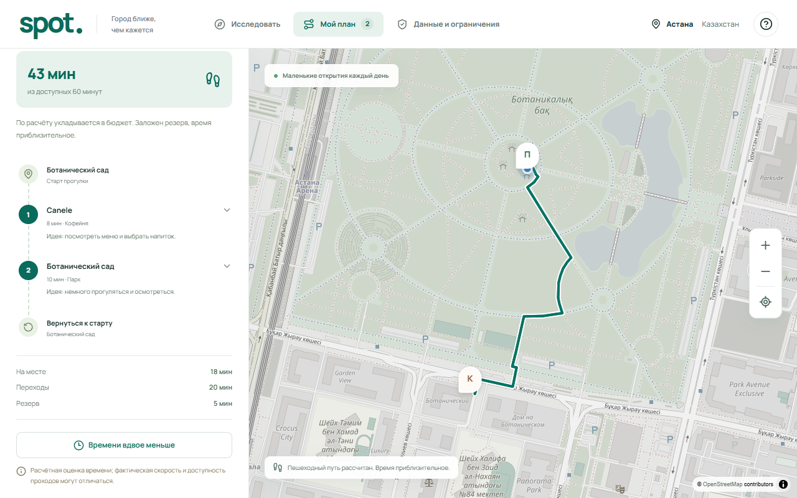
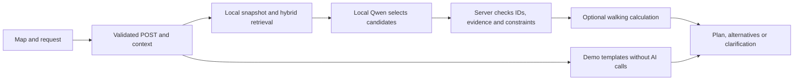

<p align="center">
  
</p>

<h1 align="center">Astana, within your time</h1>

<p align="center">A local AI assistant for short walks in Astana.<br />Choose a starting point, set your time and conditions, and explore a plan grounded in real places.</p>

<p align="center">
  
  
  
  
</p>

<p align="center">
  <a href="#getting-started">Get started</a> ·
  <a href="docs/README.md">Documentation</a> ·
  <a href="docs/verification.md">Verification</a> ·
  <a href="docs/privacy.md">Privacy</a>
</p>



*Actual local RAG run, 18 October 2026: an estimated 43 of 60 minutes, including return and a five-minute reserve, from a public demo start. One verified example. Map: © OpenStreetMap contributors. [Credits](docs/assets/README.md).*

## What Spot does

Spot plans one to three nearby places around your start, available time, required stops and return. Built for the **Smart City track of Build with AI**, it focuses on Astana.

- **Persistent context.** Follow-ups retain time, start and hard constraints; visible controls let you edit them.
- **Required stops.** Café, park and restaurant stages respect explicit order. Incomplete plans do not become silent partial successes.
- **Grounded AI.** Geography, text and vectors feed local Qwen; the server validates source IDs and evidence.
- **Honest timing.** Walking estimates include visits, reserve and return. Unverified alternatives remain clearly labelled.
- **Transparent sources.** Facts, unknowns and provider modes appear beside a dedicated data disclosure.
- **Responsive UI.** Map/list views, galleries, manual/GPS start and planned Astana time (UTC+5). Main actions support RU/KK/EN; translation is partial.

## Tech stack

| Area | Implementation |
| --- | --- |
| Application | Next.js 16 App Router, React 19, TypeScript 6 |
| Interface | CSS, Manrope, Lucide, MapLibre GL |
| Local AI | Ollama, `qwen3:0.6b`, `embeddinggemma` with 768-dimensional vectors |
| Data and validation | OpenStreetMap snapshot, source provenance, Zod |
| Checks | Vitest, Playwright, ESLint and an executable verification harness |
| Optional | Supabase, OpenAI, NVIDIA/GLM; explicit opt-in only |

## Architecture



Local Qwen returns shortlist indexes. The server binds facts and validates the full plan. Data indexing is RAG, **not training Qwen's weights**. [Architecture](docs/architecture.md).

## Getting started

### Install and run the demo

Use **Node.js 24 LTS** and npm (the package accepts Node.js 22 or newer). The complete project is on `main`.

```bash
git clone https://github.com/karimbeksultan/Spot.git
cd Spot
npm ci
npm run build
npm run demo
```

Open **http://127.0.0.1:3000**. No API key or database is required.

Demo uses the real snapshot, deterministic templates and a fixed clock. It makes no AI, database or routing calls. Map tiles and photos still need a network. Demo does not verify live RAG.

For development: `npm run dev`. Rebuild application changes before using the production `demo` or `local` command.

### Run local RAG

Install and start Ollama separately, then make these models available:

```bash
ollama pull qwen3:0.6b
ollama pull embeddinggemma
npm run build
npm run local
```

Models are separate downloads. The Windows portable starter manages an already prepared runtime and downloads nothing. [Model setup](docs/local-model-audit.md).

For a separate server deployment or access from a phone on your LAN, configure the bind address and explicit browser origins as described in [self-hosted deployment](docs/deployment.md). Local startup keeps its loopback defaults.

The compatible local vector index is included. To inspect an indexing plan without embedding calls:

```bash
npm run data:index-local -- --dry-run
```

Reindex after changing embedding specifications or source documents. Generation is local; optional walking calculations use an external service.

### Environment variables

Defaults are documented in [`.env.example`](.env.example). Copy it to `.env.local` when you need overrides; never commit the local file or server keys.

| Setting | Purpose |
| --- | --- |
| `OLLAMA_BASE_URL` | Loopback endpoint, default `http://127.0.0.1:11434` |
| `OLLAMA_CHAT_MODEL` / `OLLAMA_EMBED_MODEL` | Compatible local generation and embedding models |
| `ROUTING_ENABLED` | `false` disables external routing; total timing remains unverified |
| `APP_MODE` | `demo` or `live`; launch commands set it explicitly |
| `ALLOW_LIVE_API` / `ALLOW_PROVIDER_FAILOVER` | Cloud spending and failover gates, both off by default |

`npm run local` clears cloud credentials and disables cloud failover. Supabase and cloud models are optional. A key alone does **not** authorize spending: expiry, finite budgets and a request cap are required. Cloud live access is unverified. [Provider policy](docs/PROVIDER_CAPABILITIES.md).

## Usage

1. Choose a start, time budget, return condition and **Now** or planned Astana time.
2. Try `Сначала кофе в кафе, затем парк. Есть 60 минут, нужно вернуться.`
3. Review stages, unknowns and route status. Refine using the context controls.
4. Check sources before leaving. Google Maps opens the public place without your personal start.

## Data, privacy and limitations

The **18 October 2026 snapshot** contains 2,170 indexed OSM records: 2,165 searchable, five quarantined city mismatches. It is incomplete: 337 places have hours, 14 have 60 licensed photos, and confirmed outlet/price data are absent.

Coordinates use bounded POST bodies, not URLs. The app stores no query/movement history in a database or localStorage; query vectors may remain in memory for five minutes. Qwen receives no dedicated exact-start field, but user text may contain personal data. Tiles, photos and enabled routing have external data flows. [Privacy](docs/privacy.md) · [Sources](docs/data-sources.md) · [Data license](data/LICENSE.md).

The bounded parser does not guarantee arbitrary dishes, repeated stop types, current menus or service times. Booking, airport transfer, whole-day plans, weather/events and group optimization are absent. Walking time, access, safety and optimality are not guaranteed. Field usefulness has not been measured.

## Verification

```bash
npm run doctor
npm run verify
```

`verify` runs lint, type checks, unit tests, data validation, snapshot evaluation, evaluation cases, build and smoke checks. These checks isolate paid providers. Run browser checks separately against a running demo server:

```bash
npx playwright install chromium
npm run test:e2e
```

Browser fixtures and actual local AI/routing checks have different scopes. Tests do not establish real-world usefulness or route safety. See [verification and limitations](docs/verification.md) and [GitHub Actions](https://github.com/karimbeksultan/Spot/actions).

## Project structure

```text
src/app/           Pages, styles and API routes
src/components/    Map, search, plan, galleries and data disclosure
src/lib/           Domain rules, retrieval, providers and validation
data/              POI snapshot, provenance, vectors and data licenses
scripts/           Collection, indexing, local modes and verification
tests/             Unit, evaluation and browser scenarios
supabase/          Optional database schema and migrations
docs/              Architecture, data sources, privacy and verification
```

## Troubleshooting

| Symptom | Check |
| --- | --- |
| Production build is missing | Run `npm run build` before `npm run demo` or `npm run local` |
| Port 3000 is occupied | Stop your previous Spot server; leave unrelated processes alone |
| Local model is unavailable | Check the loopback endpoint and both installed model names |
| No matching result | Review required stages, radius and unknown facts; hard conditions stay active |
| Walking is unverified | Check routing availability; straight-line distance cannot confirm the plan |
| Map or photo is blank | Check network availability; the place list remains usable without tiles |
| Browser executable is missing | Run `npx playwright install chromium` before browser tests |

## Project documentation

- [Documentation overview](docs/README.md)
- [Architecture](docs/architecture.md)
- [Data sources and image rights](docs/data-sources.md)
- [Privacy](docs/privacy.md)
- [Verification and limitations](docs/verification.md)
