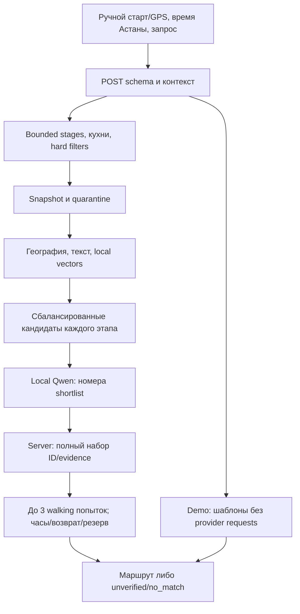

# Архитектура Spot — R2

R2 — проверенная ревизия; экспорт материалов и запись имеют отдельную готовность.

Основной путь: реальные локальные OSM POI → география/текст/совместимые embeddinggemma векторы → локальная Qwen3:0.6b → server evidence/constraints → optional walking → UI. Платные провайдеры и Supabase не обязательны.

Сохранено и проиндексировано **2170 OSM POI**; в runtime допускаются **2165**. Пять записей с явным другим городом Косшы/Қосшы помещены в карантин без удаления payloads/векторов. Допустимые категории: 354 кафе, 179 парков/садов, 346 площадок, 72 landmarks, 8 музеев, 1206 other, включая скамейки и исходные типы ресторанов. В допустимом наборе 337 расписаний и 190 адресов, у 14 мест 60 лицензированных фото; подтверждённых розеток и цен нет. В сохранённом наборе 338 расписаний/195 адресов. Это ограниченное покрытие OSM, не полный каталог города и не проверенная административная граница для объектов без addr:city.

Индекс 2170x768/version1 фиксирует embedding модель, версию, размерность и hash документов. Второй этап:1705 reused,465 new,425 unique documents,54 локальных embedding batch calls,0remote, training=false. R2 не меняет сохранённые payloads или vectors; sourceFacts выводятся из сопоставленных исходных OSM provenance на runtime. source-type/cuisine evidence не придумываются по имени.

## Оркестрация

1. POST схема ограничивает input, до 3 journey stages, время 1–240 мин и явный offset startTime. UI planned date — Astana UTC+5, независимо от timezone устройства. Смена контекста отменяет устаревший запрос.
2. Airport/booking/strict unknown price/несовместимые или заведомо невозможные этапы дают early clarification/no_match; отсутствие любого обязательного stage не вызывает ненужное embedding/generation. Unknown не проходит обязательное условие.
3. Snapshot reader исключает malformed/duplicate и 5 явных city mismatches. До ранжирования берутся in-radius candidates, Map endpoint ограничен отдельно. Restaurant matching требует venue_type evidence и ALL cuisine evidence.
4. Local embedding проверяет совместимость и AbortSignal. В памяти процесса сохраняется до 32 валидированных query-векторов, TTL5 мин, ключ SHA256(query+embedding spec). Сырой текст и точный старт в cache не записываются; результат/план не кэшируется. Abort не возвращает устаревший кешированный результат.
5. Prompt `spot-grounded-choices-v4`: не более 6 candidates, query≤400characters, source venue/cuisine, относительная дистанция; без точного старта, сырых source pages, секретов, callable tools и свободных фактов. Local chat4threads, output32tokens, context2048; embedding2threads. Qwen ранжирует индексы, но не может убрать обязательную остановку.
6. Предлагаемые посещения составного плана: кафе 8 мин, парк 10 мин, ресторан 25 мин. Это плановые значения, а не измеренная очередь/обслуживание. Сервер проверяет полные комбинации, не больше трёх walking попыток, часы на прибытие и весь визит, резерв 5 мин и возврат. Если полный набор не помещается или один этап не подходит, успешный поднабор не выдаётся. Отбор ограничен несколькими комбинациями и не гарантирует оптимальный маршрут или отсутствие иного подходящего плана в городе. Координаты POI могут быть центрами геометрии, а не проверенными входами; привязка маршрутизатора к графу не подтверждает фактическую доступность входа. Без рассчитанного walking обе остановки могут показываться только как непроверенные варианты: journey=unverified, общая длительность=null, линия готового маршрута отсутствует.
7. Ответ отдельно сообщает kind/mode/provenance/journey. `complete` требует всех этапов и fitting walking; без маршрута `unverified`/alternatives; без полного решения `incomplete`/no_match. Модель не является единоличным автором финального маршрута.

Составной запрос поддерживает до трёх обязательных этапов cafe/park/restaurant. Явное «затем» задаёт порядок; AND требует все названные этапы, OR остаётся альтернативами. Ресторан подтверждается исходным amenity=restaurant и связанным evidence, кухня — точными source-токенами и evidence для каждого запрошенного значения. Модель не выводит кухню из названия. Неизвестная кухня/обязательное удобство не заменяются случайным местом. Указанные 5 минут сохраняются, а не повышаются скрыто.

| Компонент | Роль |
| --- | --- |
| types/domain/hours | схемы, evidence, tri-state, bounded opening-hours, бюджет |
| journey/journey-search | намерения, все обязательные этапы, source кухня, атомарный план |
| retrieval/local-index/place-scope | local snapshot/geo/text/vector, compatibility, quarantine |
| model/server providers/config/budget | bounded local model, optional cloud gates/ledger |
| SpotApp/ui-time/ui-copy | редактируемый контекст, язык, плановый старт, источники, честные labels |
| scripts/data + scripts/harness | отдельный importer/indexer; offline doctor/verify/eval/smoke |

Code digest: `906ae60d3bf0843f6bc6eb09f5605e4c66dc81e0796bff1baf45099d39e9957b`. Core verify R2 PASS: artifacts/verification/2026-10-18T18-12-20-902Z-22916-verify/report.json, все 8 шагов exit0: lint/typecheck/unit/data/snapshot/eval/build/smoke.265 unit в 21 файле, snapshot18/18, обычный eval10/10 (4development+6acceptance), data2170, smoke3 шага. Code digest906ae60d…9957b стабилен до/после; applicationFilesChangedDuringChecks=false. Eval/smoke выполнялись без сети и платных запросов.

Browser R2 PASS: artifacts/verification/browser-r2-summary-20261018.json и raw browser-r2-20261018.json, exit0,38/38,0skipped/unexpected/flaky,356131.285ms; source digest906ae60d…9957b стабилен. Production localhost:3000, APP_MODE=demo;8context+8planned-journey+5data-limits+5photo+12app. Context/photo/planned-journey используют явно отмеченные UI fixtures (включая synthetic walking legs); app suite использует реальный demo snapshot. Ни local, ни cloud generation этим browser прогоном не проверяются.

Фактически выполнены 3 составных local запроса: B40 мин/возврат — no_match за 15.506 с, все 3 полные попытки исключены по time_budget; The Garden → Парк защитников Отечества G90 мин — complete,58 мин за 13.393 с; отдельный разрешённый B60 мин/возврат — Canele → Ботанический сад, complete,43 мин за 11.672 с. Это 2 положительных маршрута и 1 честный отказ; исходный two-case runner завершился exit1 из-за ошибочного ожидания положительного 40 мин ответа, raw ошибка сохранена. Receipt artifacts/verification/local-compound-r2-20261018/summary.json; source/data unchanged. Всего 3 loopback embedding +3 chat +5 Valhalla requests, paid0/training=false. Замеры относятся к actualSearchElapsedMs, без последующих assertions/hash checks; cold model load включён, warm path не измерен.

Doctor R2 PASS: artifacts/verification/2026-10-18T18-16-24-293Z-30204-doctor/report.json, network0; ключи не читались и endpoints не вызывались. Security R2 PASS: artifacts/verification/security-r2-20261018/report.json,5 scoped source/bundle/privacy checks, credential patterns0, тот же 906ae60d…digest; это ограниченный scan, не pentest. WEATHER R2 PASS: artifacts/verification/weather-r2-20261018/report.json, recommendations3 кафе и предупреждение о неподключённой погоде, network0/paid0, тот же digest.

Зафиксированное сравнение: **5/14 BEFORE → 14/14 AFTER** по одним и тем же 14 запросам, публичным точкам, часам и семантическим assertions. AFTER networkAttempts=0, paidRequests=0; sourceUnchanged=true. Receipt: `artifacts/verification/quality-r2-20261018/after.json`, исходный BEFORE: `before.json`, его SHA256 `b7e7defed44af0f08529780a6e761d6629c6318d36fa7163124a100fba0e46af`. Это детерминированная приёмка небольшой выборки, без LLM judge, человеческой оценки, балла 8–9 или гарантии top-10.

Неполные часы/адреса/фото/удобства, OSM freshness и bounded grammar остаются ограничениями. Текстовый parser берёт первое упоминание каждого типа cafe/park/restaurant: повтор одного типа в нескольких остановках и произвольное название блюда без явного restaurant не являются проверенными сценариями. Теги ресторана/кухни не подтверждают актуальное меню, наличие конкретного блюда, свободный столик, длительность обслуживания или санитарное состояние. Бронирование, аэропортовый трансфер, forecast/events/CV, all-day itinerary и групповой оптимизатор не реализованы. Пешее время — оценка; безопасность/безбарьерность/прибытие к рейсу не гарантируются. RU/KK/EN основные действия и отдельные запросы не равны полному переводу или экспертной языковой оценке. Независимого исследования полезности с людьми нет.

Предыдущий выпуск R1 сохранён отдельно в `work/quality-pass-20261018/r1/` с manifest. Его code digest `38b0380549c6b8b8b86b92479020fc1d0b639603ed0748bb93a481f93eac1dc4`, core197/17, snapshot18/18, eval10/10, browser30/30 и local5 являются историей R1. Исходный R1 scenario MD SHA256 `606ecf1ef0874a5d4bc1cbb698512fc7ae28f3cfb03933bc4b5d427b1a894565`, PDF SHA256 `3278754fbb49e35b96042dcc1843428173c48b97d4ad44b28df8a1cf6d2e4572`. Эти доказательства не объявляются проверкой изменённого R2 кода.
