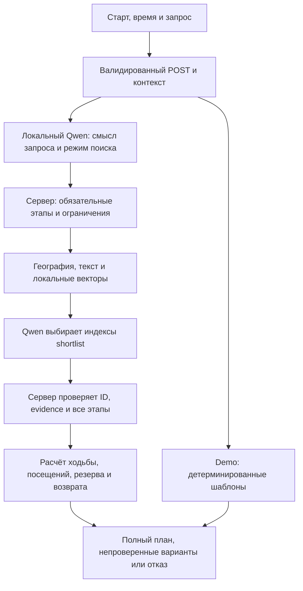

# Архитектура Spot

Приложение использует Next.js App Router, React и TypeScript. Основной режим работает с локальным снимком OpenStreetMap, векторами embeddinggemma и Qwen через Ollama. Веса Qwen не дообучались: городские факты поступают через RAG.

## Поиск и планирование

1. Сервер проверяет схему запроса, старт, время 1–240 минут и до трёх этапов `cafe` / `park` / `restaurant`. Плановое время интерфейса относится к Астане, UTC+5. Изменение контекста отменяет устаревший запрос.
2. Retrieval исключает карантинные записи и отбирает места в радиусе старта по географии, тексту и совместимым векторам. Неизвестное обязательное свойство не считается подтверждённым.
3. Модель получает короткий список кандидатов, source facts и приблизительные расстояния. Она возвращает индексы списка; произвольные названия и факты не принимаются. Выделенное поле точного старта в модель не передаётся.
4. Сервер связывает результат с реальными POI и evidence. Тип ресторана и каждая запрошенная кухня требуют исходных тегов; название заведения не заменяет доказательство. Все обязательные этапы сохраняются.
5. До трёх комбинаций проверяются маршрутизатором. В расчёт входят посещения, часы на момент прибытия и на весь визит, резерв пять минут и требуемое возвращение.

Плановые посещения: кафе — 8 минут, парк — 10, ресторан — 25. Это допущения планировщика, не измеренные очередь и обслуживание. `complete` требует рассчитанной ходьбы и соблюдения всех условий; без маршрута результат остаётся `unverified`, с неизвестной общей длительностью. Успешная часть неполного обязательного плана не выдаётся за весь план.

Названия мест в запросе не обязательны. В local-режиме отдельный вызов Qwen переводит смысл свободного текста в строгую структуру: действия, порядок, повторения, интересы и выбор между списком вариантов и совместным планом. Модель не возвращает названия заведений, координаты, ссылки или факты. Исходные ограничения по времени, старту, возврату, обязательным свойствам и кухне остаются под контролем сервера. Неоднозначный, неподдерживаемый или не прошедший проверку разбор приводит к уточнению до retrieval. Веса модели не дообучались.

«Где поесть / отдохнуть / что посмотреть» может вернуть до трёх независимых вариантов; они не складываются в один маршрут. Для каждого отдельно проверяются доступное время, путь, посещение, резерв, возврат и часы. Запрос с несколькими действиями планируется целиком, максимум три остановки. Повторная еда после кофе требует другого подтверждённого POI. Отдых на улице интерпретируется как парк: скамейки, тишина и другие удобства этим не подтверждаются.

Явный старт в начале фразы («нахожусь около…», «я у…», «I am near…») сопоставляется с точным именем из валидированного снимка до модели. Если он отличается от выбранной точки, пользователь подтверждает найденный объект или сохраняет выбранный старт. Только найденное имя маскируется при разборе целей; исходный текст, время и ограничения сохраняются. Координаты берутся из снимка, неизвестные названия не геокодируются догадкой.

## Компоненты

| Область | Роль |
| --- | --- |
| `src/app` | Страницы, API, схемы входа и серверные ошибки |
| `src/components` | Карта, поиск, контекст, план, галереи и раскрытие источников |
| `src/lib/journey*` | Намерения, обязательные этапы и единый план |
| Retrieval / local index | Снимок, география, текст, векторы и карантин |
| Providers / config / budget | Локальная модель и необязательные облачные адаптеры |
| `scripts/data` | Сбор, валидация, provenance и индексация |
| `scripts/harness` | Изолированные doctor, verify, eval и smoke |

Query-векторы могут храниться в памяти до пяти минут: не более 32 записей, ключ — хеш запроса и спецификации embedding. Сырой текст и точный старт в этот кэш не записываются; готовые планы не кэшируются. Пользовательский текст всё равно может содержать личные сведения.

Demo сохраняет детерминированный разбор, настоящий снимок и фиксированное время; модель понимания, генерация, БД и маршрутизатор не вызываются. Карта и фотографии остаются внешними сетевыми ресурсами. Детали: [приватность](privacy.md), [провайдеры](PROVIDER_CAPABILITIES.md), [проверки](verification.md).
